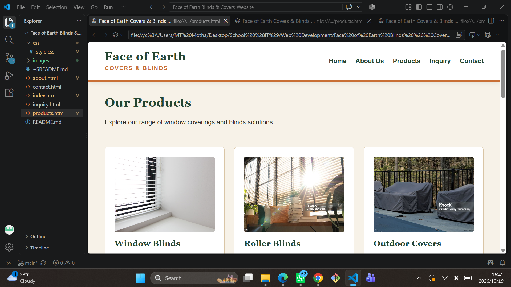
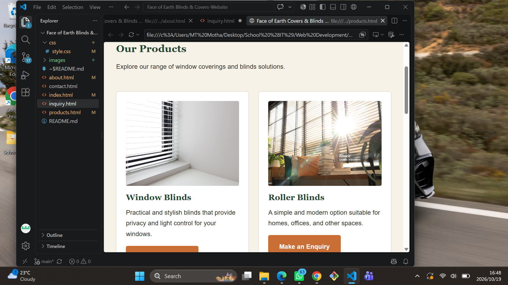
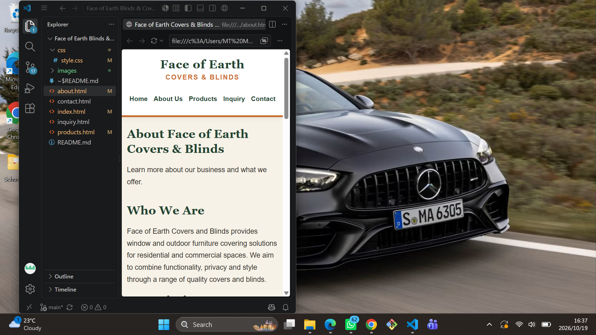
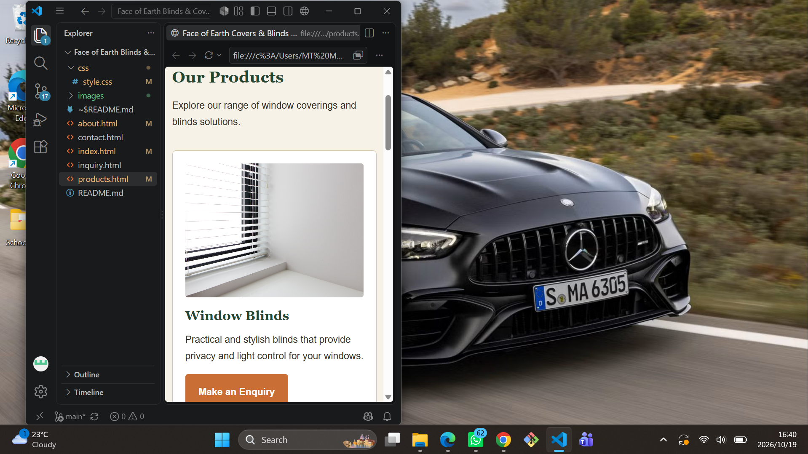
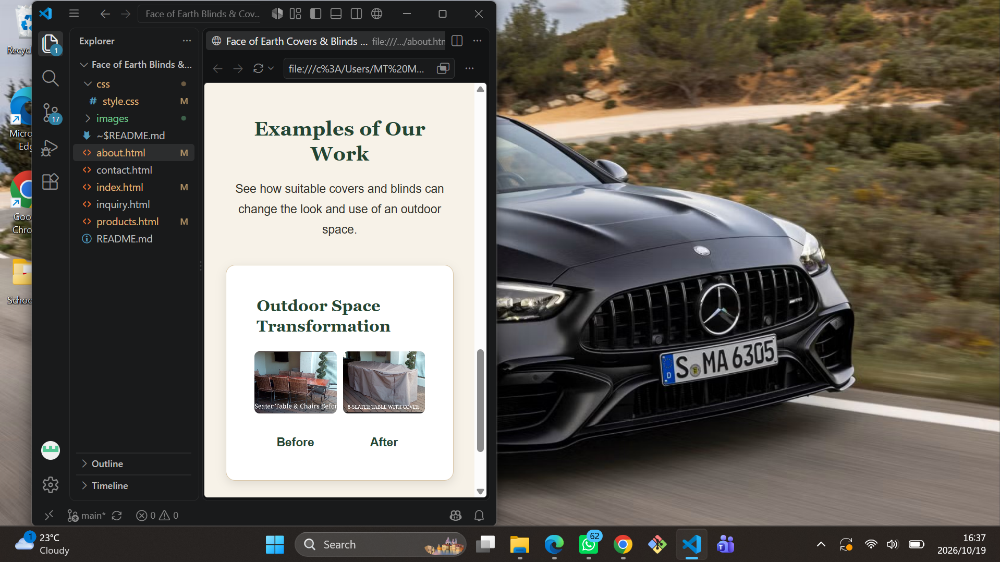

Face of Earth Covers & Blinds Website

About the Project

This project is a website being developed for Face of Earth Covers & Blinds as part of my Web Development academic project.

The purpose of the website is to give potential customers a simple way to learn about the business, view its products and services, make an enquiry and find contact information.

Part 1 focused on creating the basic website structure and content. Part 2 builds on that foundation by improving the visual design, applying CSS styling, adding product images and galleries, and making the layout responsive.

Website Pages

* Home (index.html) – Introduces the business and provides an overview of its products and services.
* About (about.html) – Provides information about the business, its purpose and values.
* Products (products.html) – Displays product photographs and examples of covering solutions.
* Inquiry (inquiry.html) – Provides an enquiry form for customers interested in the products or services.
* Contact (contact.html) – Provides contact information and business hours.

The navigation menu connects the different pages so visitors can move around the website.

Project Structure

Face of Earth/
│
├── index.html
├── about.html
├── products.html
├── inquiry.html
├── contact.html
├── README.md
│
├── css/
│   └── style.css
│
├── images/
│   ├── custom-solutions.jpeg
│   ├── outdoor-covers.jpeg
│   ├── roller-blinds.jpeg
│   ├── window-blinds.jpeg
│   └── before-and-after images
│
├── js/
└── documents/
    └── screenshots/

Technologies Used

* HTML5: Creates the structure and content of the website.
* CSS3: Controls colours, typography, spacing, layouts and responsive behaviour.
* JavaScript: Reserved for possible interactive functionality in later development.
* Git: Tracks changes made to the project.
* GitHub: Stores the repository and publishes the website.
* Visual Studio Code: Used to edit and manage the project files.

Design and Styling

An external stylesheet, css/style.css, is used to style the website pages consistently.

The design uses an earthy colour palette consisting of forest green, terracotta orange, warm cream and natural beige. These colours were selected to suit the business’s focus on window coverings and outdoor solutions.

CSS improves the typography, spacing, navigation menu, buttons, product cards, image presentation and page layouts. Flexbox and CSS Grid are used to organise content. Hover and focus states improve the presentation and usability of interactive elements.

Images and Product Galleries

Product photographs and before-and-after examples have been added to make the website more informative and visually appealing.

The Products page displays images for window blinds, roller blinds, outdoor covers and custom solutions. It also contains a before-and-after gallery. Additional image galleries are included on the Home and About pages.

The images are stored in the images/ folder and referenced from the relevant HTML pages. Alternative text is provided to describe images, and CSS helps them fit their containers.

Responsive Design and Testing

Responsive design was introduced in Part 2 to improve the website experience on different screen sizes.

CSS media queries, relative sizing, Flexbox and CSS Grid help the layout adapt to narrower screens. Images are styled to fit their containers, and spacing and layouts can change according to the available screen width.

The website was tested by reducing the browser window to a phone-like width and checking whether the layout adjusted accordingly. The screenshots below provide evidence of the website at different screen sizes.

Screenshots and Testing Evidence

Important: Replace each placeholder below with your own screenshot. Use screenshots of your actual website, not example images.

1. Desktop View

Caption: Figure 1: Face of Earth Covers & Blinds website displayed at desktop screen size, showing the main layout and visual styling.

-->

2. Tablet View

Caption: Figure 2: Face of Earth Covers & Blinds website displayed at tablet screen size, showing how the layout adjusts to a narrower viewport.

-->

3. Mobile View

Caption: Figure 3: Face of Earth Covers & Blinds website displayed at mobile screen size, showing the responsive layout on a narrow screen.

-->

4. Product Images and Gallery

Caption: Figure 4: Products page displaying product photographs and before-and-after images.

-->

Development Progress

Part 1: Website Structure and Content

The Part 1 work included:

* Planning the website concept and content.
* Creating the five website pages.
* Adding the basic HTML structure and initial content.
* Adding navigation between the pages.
* Creating the project folder structure.
* Adding the initial README documentation.
* Creating the Git repository and committing project changes.
* Preparing the website for publishing through GitHub.

Part 2: Visual Design, CSS and Responsive Design

The Part 2 work included:

* Creating and applying an external CSS stylesheet.
* Applying a consistent colour palette and typography.
* Improving page layouts, spacing, navigation and buttons.
* Using Flexbox and CSS Grid to organise content.
* Adding product photographs and before-and-after galleries.
* Styling product cards and image sections.
* Applying responsive CSS rules and media queries.
* Resizing the browser to check the layout on a narrower screen.
* Updating this README to document the work and provide screenshot evidence.

No formal feedback was received for Part 1. The changes documented in Part 2 therefore reflect improvements made during development rather than changes requested through feedback.

Part 3: Further Development

Further improvements and functionality will be added according to the Part 3 assignment requirements.

Change Log

Stage	Changes made
Part 1	Created the website pages, basic HTML structure, navigation, initial content and project documentation.
Part 2	Applied consistent CSS styling and an earthy colour palette.
Part 2	Added product photographs and before-and-after galleries.
Part 2	Applied responsive layout rules and media queries, then tested the layout by resizing the browser.
Part 2	Updated the README to document the improvements and provide spaces for testing screenshots.

Learning Resources

The following resources support my learning and development of the website.

HTML

Mozilla Developer Network (MDN). (2026). HTML: Creating the content. Available at: https://developer.mozilla.org/en-US/docs/Learn_web_development/Getting_started/Your_first_website/Creating_the_content (Accessed: 19 October 2026).

W3Schools. (2026). HTML Tutorial. Available at: https://www.w3schools.com/html/ (Accessed: 19 October 2026).

CSS and Responsive Design

Mozilla Developer Network (MDN). (2026). Getting started with CSS. Available at: https://developer.mozilla.org/en-US/docs/Learn_web_development/Core/Styling_basics/Getting_started (Accessed: 19 October 2026).

W3Schools. (2026). CSS Tutorial. Available at: https://www.w3schools.com/css/ (Accessed: 19 October 2026).

JavaScript

Mozilla Developer Network (MDN). (2026). Dynamic scripting with JavaScript. Available at: https://developer.mozilla.org/en-US/docs/Learn_web_development/Core/Scripting (Accessed: 19 October 2026).

W3Schools. (2026). JavaScript Tutorial. Available at: https://www.w3schools.com/js/ (Accessed: 19 October 2026).

Git and GitHub

Git SCM. (2026). Git Documentation. Available at: https://git-scm.com/doc (Accessed: 19 October 2026).

GitHub Docs. (2026). GitHub Documentation. Available at: https://docs.github.com/ (Accessed: 19 October 2026).

YouTube Learning Resources

freeCodeCamp.org. (2020). Git and GitHub for Beginners - Crash Course. YouTube. Available at: https://www.youtube.com/watch?v=RGOj5yH7evk (Accessed: 19 October 2026).

freeCodeCamp.org. (2022). CSS Tutorial – Full Course for Beginners. YouTube. Available at: https://www.youtube.com/watch?v=OXGznpKZ_sA (Accessed: 19 October 2026).

Other online tutorials may be consulted when additional explanations or practical examples are needed.

Author

Mahluli Motha

Academic Project: Web Development